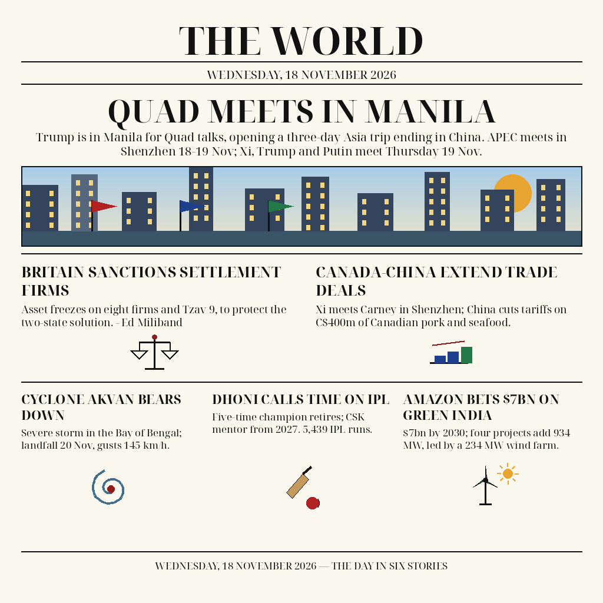

# THE WORLD — 18 November 2026

A newspaper front page summing up 18 November 2026's world news in one
image. Built for the make.fun bounty
[news-image-20261118](https://make.fun/bounty/news-image-20261118).



## The six stories

1. **Quad meets in Manila** — President Donald Trump is in Manila for
   Quad leaders' talks, the first stop of a three-day Asia trip ending in
   China. APEC leaders meet in Shenzhen on 18–19 November, and China
   confirmed Xi Jinping, Trump and Vladimir Putin will meet in Shenzhen
   on Thursday 19 November.
2. **Britain sanctions settlement firms** — Britain sanctioned eight
   Israeli construction and property firms building settlements in the
   occupied West Bank, plus activist group Tzav 9. Asset freezes and
   director disqualifications, announced by Foreign Secretary Ed Miliband,
   aim to protect the two-state solution.
3. **Canada–China extend trade deals** — Xi Jinping met Mark Carney in
   Shenzhen; China cuts tariffs on about C$400 million of Canadian pork
   and seafood, while Canada extends steel and aluminium remission
   measures by two years.

4. **Cyclone Akvan bears down** — Akvan intensified into a Severe
   Cyclonic Storm over the Bay of Bengal on 18 November, per the India
   Meteorological Department. Landfall is forecast around noon on
   20 November on the Andhra Pradesh and Yanam coasts, with winds of
   120–130 km/h gusting to 145 km/h. Andhra Pradesh and Odisha are on
   alert.
5. **Dhoni calls time on IPL** — MS Dhoni's IPL playing career has ended;
   the five-time champion will be Chennai Super Kings' mentor from
   IPL 2027. He scored 5,439 IPL runs and sat out the 2026 season with
   a calf injury.
6. **Amazon bets $7bn on green India** — Amazon plans to invest $7 billion
   in renewable energy in India by 2030, on top of $4 billion already
   contracted: four new wind and solar projects totalling 934 MW,
   including a 234 MW wind farm in Karnataka, its largest wind project
   contracted in Asia.

## How it is made

`gen_image.py` draws the whole page with Pillow and the Python standard
library only — masthead, dateline, lead story, a skyline hero band, two
mid stories and three lower stories, each with a small pictogram drawn
from plain shapes below its deck. No network, no external images, no
timestamps: running the script twice produces byte-identical PNGs.

## How to run

```bash
python3 gen_image.py   # writes entry.png (1024x1024, RGB)
node main.ts           # copies entry.png to /output/entry.png
```

Set `MAKEFUN_OUTPUT_DIR` to change the output directory for `main.ts`.
Requires Python 3 with Pillow, and Node 22+.
